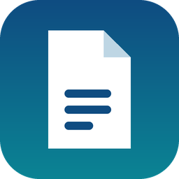
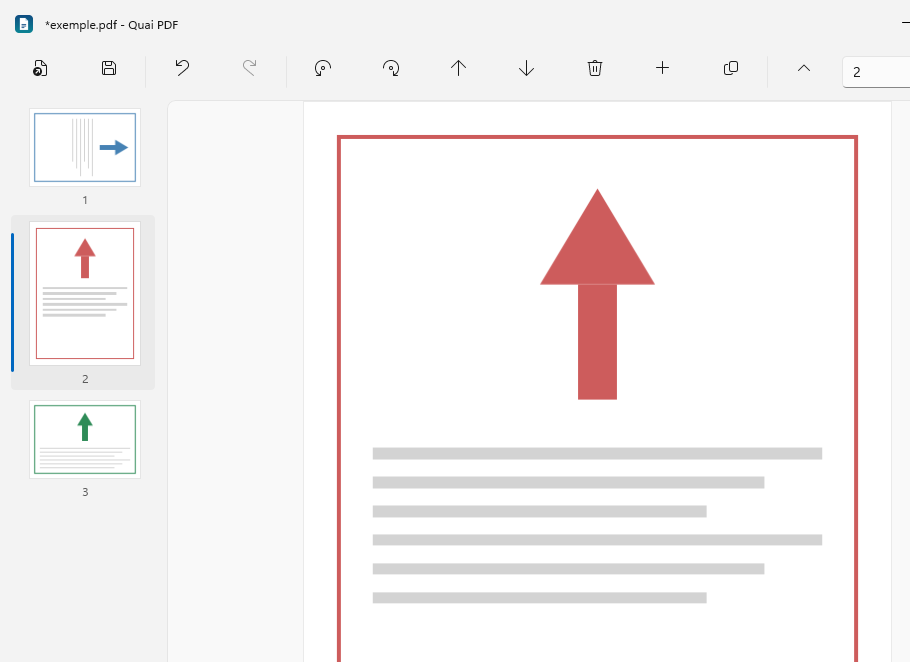
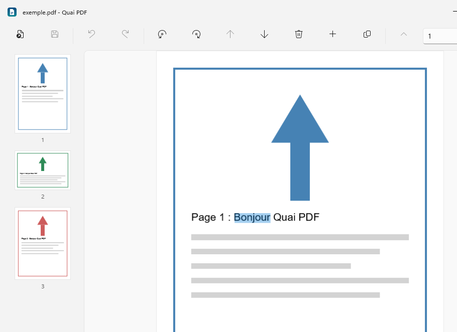
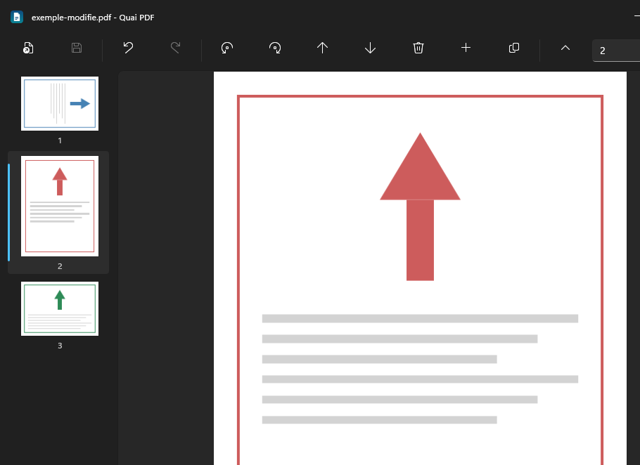

  

<h1 align="center">Quai PDF</h1>

  <b>Lire et retoucher vos PDF, simplement, dans une vraie application Windows.</b> 
  Un lecteur et éditeur de PDF de base, gratuit, pensé pour Windows 11. De la même famille que <a href="https://github.com/memton80/quai-ssh">Quai</a>.

  <a href="https://github.com/memton80/quai-pdf/releases/latest"><b>Télécharger Quai PDF pour Windows</b></a>
  · Gratuit · Sans compte · Sans publicité

## Ce que fait Quai PDF

- **Lire.** Les pages défilent, avec les vignettes à gauche, le zoom (`Ctrl+molette`, `Ctrl+Plus`, `Ctrl+Moins`) et l'ajustement à la largeur.
- **Copier du texte.** Sélectionnez à la souris comme sur une page web (double-clic pour un mot, `Ctrl+A` pour tout), puis `Ctrl+C`.

- **Remettre les pages d'aplomb.** Une page scannée à l'envers ou couchée : pivotez-la (`Ctrl+R`).
- **Réorganiser.** Faites glisser les vignettes pour changer l'ordre, ou utilisez « Monter » / « Descendre ».
- **Faire le tri.** Supprimez les pages inutiles (`Suppr` dans les vignettes).
- **Assembler.** Insérez les pages d'un ou plusieurs autres PDF après la page en cours (`Ctrl+I`).
- **Extraire.** Enregistrez quelques pages dans un nouveau PDF (`Ctrl+E`).
- **Renseigner.** Titre, auteur, sujet, mots-clés (`Ctrl+D`).
- **Changer d'avis.** Annuler (`Ctrl+Z`) et rétablir (`Ctrl+Y`) : rien n'est écrit sur le disque avant « Enregistrer ».

## Une vraie application, rien de caché

Quai PDF est une application Windows native (WinUI 3) : **aucune page web, aucun navigateur embarqué**. Les pages sont dessinées par le moteur PDF intégré à Windows, le texte est lu par [PDFium](https://pdfium.googlesource.com/pdfium/) (le moteur PDF de Chrome) et les modifications sont faites par [PDFsharp](https://github.com/empira/PDFsharp), une bibliothèque libre éprouvée. Rien n'est réinventé.

- Les documents protégés par un mot de passe s'ouvrent en **lecture seule** : leur protection n'est jamais retirée sans que vous le sachiez. Le mot de passe n'est jamais enregistré.
- **Aucune publicité, aucun pistage, aucun compte à créer.** Quai PDF ne se connecte à rien.

## Installer Quai PDF

1. Téléchargez **`QuaiPdf-Setup-x64.exe`** depuis la [dernière version](https://github.com/memton80/quai-pdf/releases/latest) (ou `QuaiPdf-Setup-arm64.exe` pour un PC Snapdragon / ARM).
2. Lancez-le : pas besoin d'être administrateur, tout est inclus.
3. C'est prêt : Quai PDF est dans le menu Démarrer, et dans « Ouvrir avec » pour vos fichiers PDF.

> Au premier lancement, Windows peut afficher « Windows a protégé votre ordinateur » : Quai PDF est un projet indépendant et ses fichiers ne sont pas encore signés. Cliquez sur **Informations complémentaires**, puis **Exécuter quand même**.

Fonctionne sur Windows 10 et Windows 11. Une version portable (zip, sans installation) est aussi proposée.

## En savoir plus

- [Le guide](docs/GUIDE.md) : toutes les fonctions, les raccourcis clavier, où sont vos données, les limites actuelles.
- [Pour les développeurs](docs/DEVELOPPEMENT.md) : organisation du code, tests, compilation, publication.
- Une idée, un bug ? [Ouvrez un ticket](https://github.com/memton80/quai-pdf/issues).

Quai PDF est gratuit et open source, sous licence MIT.
